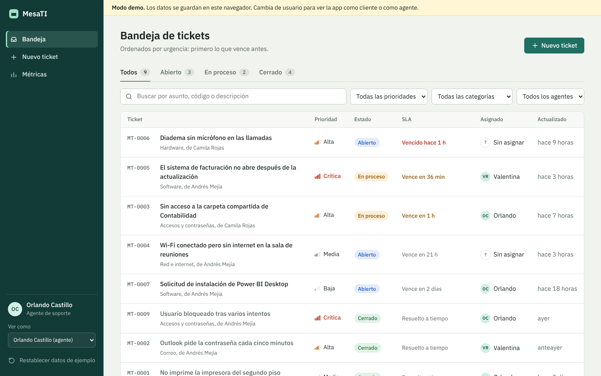
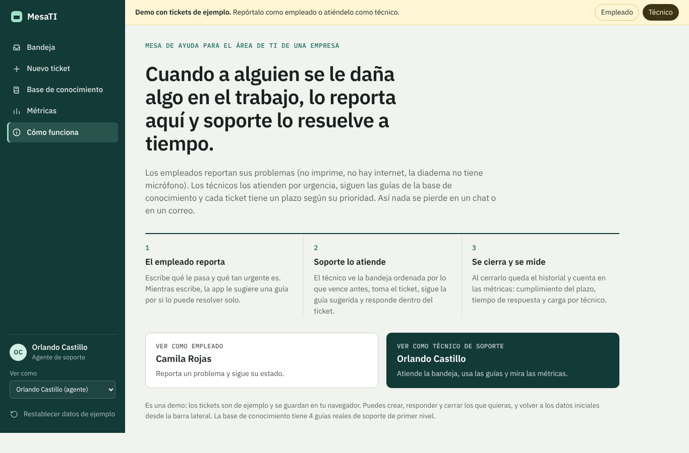
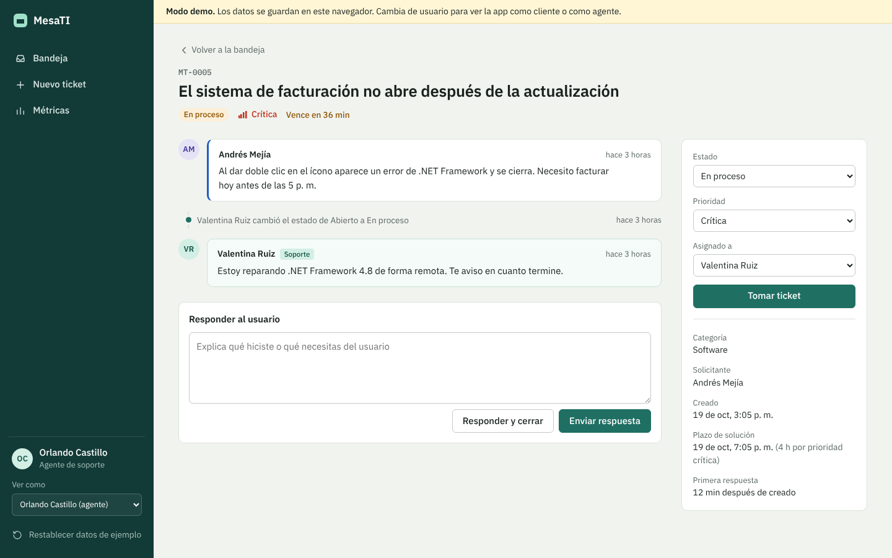
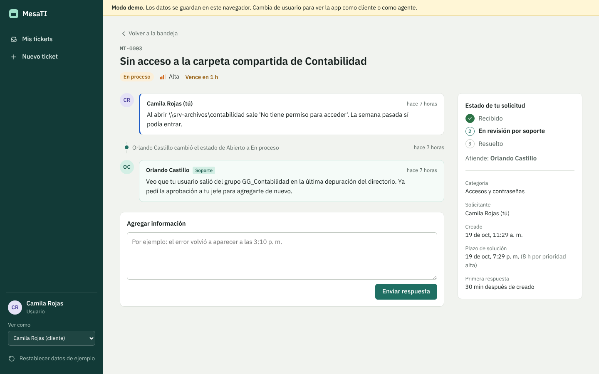
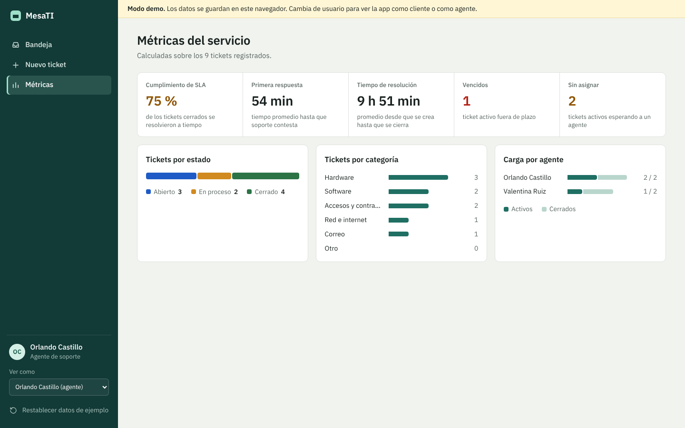
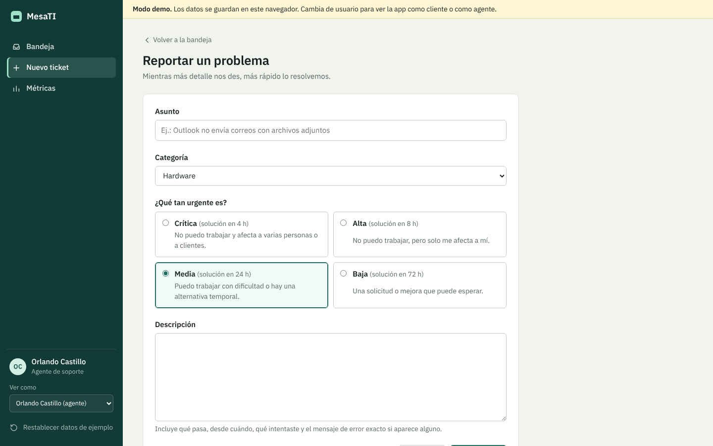
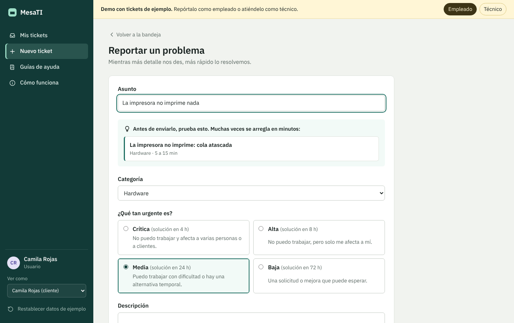
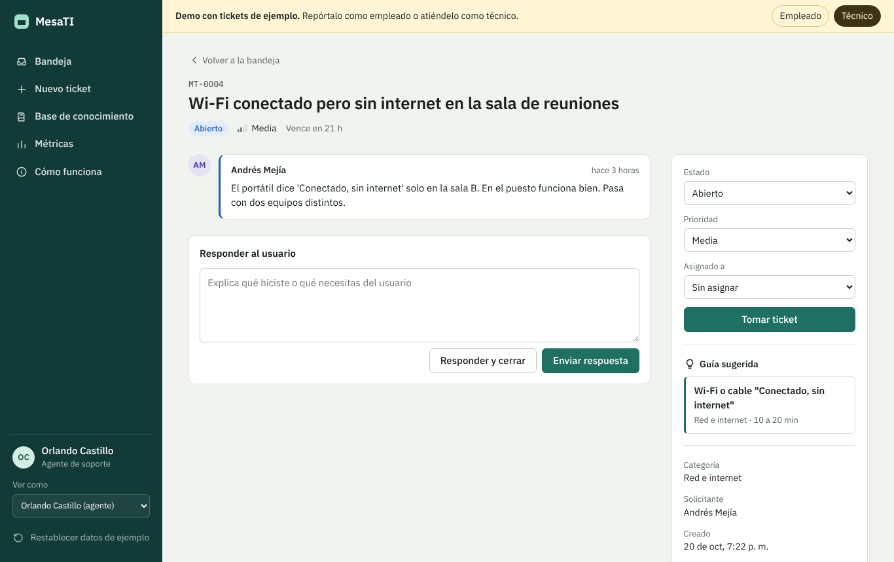

# MesaTI: mesa de ayuda para soporte técnico

Aplicación web para el área de TI de una empresa. Cuando a un **empleado** se le daña algo (no imprime, no hay internet, la diadema no tiene micrófono), lo reporta aquí. Un **técnico** lo toma, sigue la guía de la **base de conocimiento**, conversa con el empleado dentro del ticket y lo cierra. Cada ticket tiene un plazo de solución (SLA) según su prioridad, y el equipo de soporte ve métricas del servicio en tiempo real.

**En vivo:** https://mesa-ti-chi.vercel.app. La primera pantalla explica cómo funciona y deja entrar como empleado o como técnico.





**Pruébalo sin configurar nada:** si no hay credenciales de Supabase, la app arranca en *modo demo* con datos de ejemplo guardados en el navegador. Desde la barra lateral puedes cambiar entre usuarios para ver la app como cliente o como agente.

## Funcionalidades

**Para el usuario (cliente)**
- Reportar un problema con asunto, categoría, prioridad y descripción guiada.
- Ver solo sus propios tickets, con el estado en tres pasos: recibido, en revisión, resuelto.
- Conversar con soporte dentro del ticket.

**Para el agente**
- Bandeja ordenada por urgencia: primero lo que vence antes, al final lo cerrado.
- Filtros por estado, prioridad, categoría y "asignados a mí" / "sin asignar", con búsqueda que ignora tildes. Los filtros viven en la URL, así se pueden compartir.
- Tomar un ticket, reasignarlo, cambiar estado y prioridad, responder y cerrar en un paso.
- Historial automático de cada cambio (quién, qué y cuándo).
- Métricas: cumplimiento de SLA, tiempo promedio de primera respuesta y de resolución, tickets vencidos, sin asignar, por categoría y carga por agente.

| Detalle del ticket | Vista del usuario |
| --- | --- |
|  |  |

| Métricas | Nuevo ticket |
| --- | --- |
|  |  |

## Base de conocimiento

Las guías de solución de problemas de primer nivel viven dentro de la app (`src/kb/*.md`, en Markdown) y se conectan con los tickets:

- **Al reportar**, mientras el empleado escribe el asunto, la app le sugiere la guía que puede resolver su problema ("Antes de enviarlo, prueba esto"). Es lo que en soporte se llama autoservicio: menos tickets por cosas que se arreglan en cinco minutos.
- **En cada ticket**, el técnico ve la guía sugerida al lado de los controles.
- **Desde una guía**, si los pasos no funcionaron, "Reportar el problema" abre el formulario con la categoría y la guía ya anotadas.
- Los diagramas de diagnóstico se dibujan con Mermaid, que se carga solo cuando se abre una guía.
- Incluye los scripts de PowerShell que automatizan el diagnóstico (red, datos del equipo, cola de impresión).

La sugerencia (`src/domain/kb.ts`) busca palabras clave enteras, sin tildes ni mayúsculas, y suma un punto si coincide la categoría. Está probada con los tickets de ejemplo.

| Sugerencia al reportar | Guía sugerida en el ticket |
| --- | --- |
|  |  |

## Acuerdos de nivel de servicio (SLA)

| Prioridad | Cuándo usarla | Plazo de solución |
| --- | --- | --- |
| Crítica | No se puede trabajar y afecta a varias personas o a clientes | 4 horas |
| Alta | No se puede trabajar, afecta a una persona | 8 horas |
| Media | Se puede trabajar con dificultad o hay una alternativa | 24 horas |
| Baja | Solicitud o mejora que puede esperar | 72 horas |

Un ticket activo pasa a "por vencer" cuando le queda menos del 25 % del plazo. Los tickets cerrados se evalúan contra su fecha de cierre.

## Stack y arquitectura

- **TypeScript** estricto, sin framework de UI: HTML, CSS y TypeScript con **Vite**.
- **Supabase**: autenticación, PostgreSQL, Row Level Security y Realtime.
- **Vitest** para pruebas unitarias.

```
src/
├── main.ts               # arranque, enrutador por hash y ciclo de render
├── types.ts              # modelos del dominio
├── domain/               # lógica pura, sin DOM ni red (100 % testeable)
│   ├── sla.ts            # plazos y estado del SLA
│   ├── metrics.ts        # indicadores del servicio
│   ├── sort.ts           # filtros, búsqueda y orden de atención
│   └── validation.ts
├── data/
│   ├── repository.ts     # interfaz común
│   ├── supabase.ts       # implementación real
│   ├── local.ts          # modo demo con localStorage
│   └── seed.ts           # datos de ejemplo
├── ui/                   # plantillas seguras, router, toasts, componentes
└── views/                # una vista por pantalla
supabase/schema.sql       # tablas, triggers y políticas RLS
tests/                    # pruebas de dominio, repositorio y plantillas
```

Algunas decisiones que vale la pena mencionar:

- **Patrón repositorio.** Las vistas dependen de la interfaz `TicketRepository`, no de Supabase. Por eso existe el modo demo y por eso la lógica se puede probar sin red.
- **La seguridad está en la base de datos, no en el frontend.** Las políticas RLS impiden que un usuario lea tickets ajenos o cambie estados aunque manipule las peticiones. El modo demo reproduce esas mismas reglas y las pruebas lo verifican.
- **Historial con triggers.** Los cambios de estado, prioridad y asignación los registra un trigger de PostgreSQL, así ningún cliente puede saltarse el historial. También se calculan ahí `resolved_at` y `first_response_at`.
- **Plantillas HTML con escape automático** (`src/ui/html.ts`): todo texto del usuario se escapa antes de insertarse en el DOM, lo que previene XSS sin necesidad de un framework.
- **Accesibilidad:** navegación por teclado, foco gestionado al cambiar de vista, `aria-current` en navegación y pestañas, mensajes de error asociados a cada campo, `Ctrl + Enter` para enviar respuestas.

## Cómo correrlo

Requiere Node.js 20 o superior.

```bash
npm install
npm run dev          # http://localhost:5173 en modo demo
npm test
npm run build
```

### Conectar Supabase

1. Crea un proyecto en [supabase.com](https://supabase.com).
2. En **SQL Editor** ejecuta el contenido de `supabase/schema.sql`.
3. Copia `.env.example` como `.env.local` y completa `VITE_SUPABASE_URL` y `VITE_SUPABASE_ANON_KEY` (Project Settings, API).
4. Regístrate desde la app. Para convertir tu usuario en agente, ejecuta en el SQL Editor:

   ```sql
   update public.profiles set role = 'agente' where id = '<uuid de tu usuario>';
   ```

## Despliegue

Es un sitio estático: `npm run build` genera la carpeta `dist/`, que se puede publicar en Vercel, Netlify o GitHub Pages. Las variables `VITE_SUPABASE_*` se configuran en el panel del proveedor.

## Próximos pasos

- Adjuntar capturas de pantalla a los tickets con Supabase Storage.
- Notificar por correo al usuario cuando su ticket cambia de estado.
- Base de conocimiento: convertir respuestas frecuentes en artículos.
- Pruebas end-to-end con Playwright.

---

Proyecto de portafolio de Orlando Castillo. Los nombres y tickets del modo demo son ficticios.
