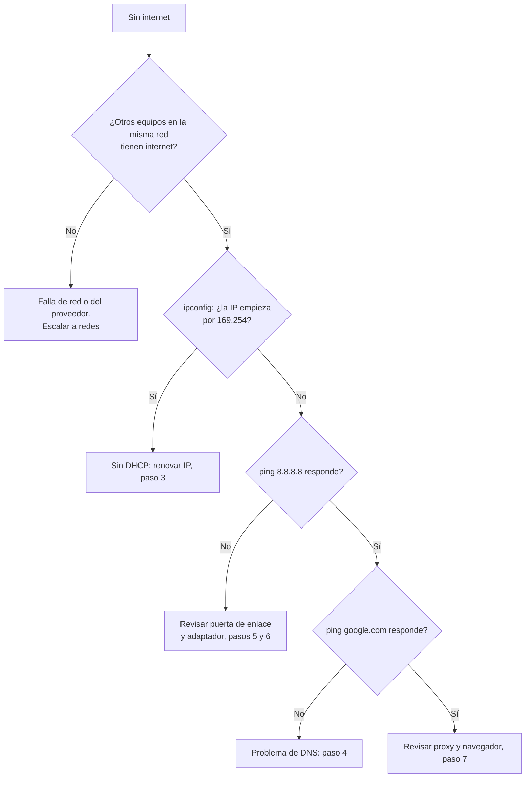

# Wi-Fi o cable "Conectado, sin internet" en Windows

| | |
| --- | --- |
| **Aplica a** | Windows 10 y 11, conexión por Wi-Fi o cable |
| **Nivel** | Soporte de primer nivel (N1) |
| **Tiempo estimado** | 10 a 20 minutos |
| **Riesgo** | Bajo. El paso 6 reinicia la configuración de red y pide reiniciar el equipo |
| **Requiere** | Permisos de administrador desde el paso 4 |

## Síntoma

El ícono de red muestra un globo o un triángulo amarillo y Windows indica **"Conectado, sin internet"** o **"Sin acceso a Internet"**. El equipo está conectado a la red local, pero no abre páginas web, Teams ni el correo.

## Causas más comunes

1. El problema no es del equipo: el router, el proveedor o el proxy de la empresa están fallando.
2. El equipo no recibió una dirección IP válida por DHCP (aparece una IP `169.254.x.x`).
3. La caché de DNS tiene registros dañados o el servidor DNS no responde.
4. La pila TCP/IP o el catálogo Winsock quedaron dañados (por ejemplo, después de desinstalar una VPN o un antivirus).
5. El controlador del adaptador de red está desactualizado o en estado de error.

## Diagnóstico rápido

La idea es descartar de afuera hacia adentro: primero la red, luego la configuración del equipo, al final el controlador.



## Solución paso a paso

### 1. Confirmar el alcance

Preguntar al usuario si otros compañeros en el mismo piso o la misma red tienen internet. Si nadie tiene, **no tocar el equipo**: el problema es de la red y se escala (ver al final).


### 2. Revisar la configuración IP

Abrir **Símbolo del sistema** (Inicio, escribir `cmd`, Enter) y ejecutar:

```cmd
ipconfig /all
```

Fijarse en el adaptador que está en uso (Wi-Fi o Ethernet):

| Campo | Valor esperado | Si no |
| --- | --- | --- |
| Dirección IPv4 | De la red de la empresa, por ejemplo `192.168.1.45` | `169.254.x.x` significa que no hubo respuesta de DHCP |
| Puerta de enlace | Una IP, por ejemplo `192.168.1.1` | Vacía: el equipo no sabe por dónde salir |
| Servidores DNS | Una o dos IP | Vacío o una IP extraña: revisar paso 4 |


Probar la conectividad en orden:

```cmd
ping 192.168.1.1
ping 8.8.8.8
ping google.com
```

En orden: la puerta de enlace que mostró `ipconfig` (cambiarla por la real), un servidor en internet por IP y un dominio, que además prueba el DNS.

- Si falla la puerta de enlace: problema entre el equipo y el router (cable, Wi-Fi, adaptador).
- Si responde `8.8.8.8` pero no `google.com`: el problema es DNS.

### 3. Renovar la dirección IP

```cmd
ipconfig /release
ipconfig /renew
```

Si después de renovar sigue apareciendo `169.254.x.x`, el servidor DHCP no está respondiendo a este equipo: probar con cable si estaba por Wi-Fi, y si persiste, escalar.

### 4. Limpiar la caché de DNS

Abrir `cmd` **como administrador** (clic derecho, "Ejecutar como administrador"):

```cmd
ipconfig /flushdns
```

Debe responder *"Se vació correctamente la caché de resolución de DNS"*. Volver a probar `ping google.com`.

### 5. Reiniciar el adaptador de red

1. `Win + R`, escribir `ncpa.cpl` y Enter.
2. Clic derecho sobre el adaptador en uso, **Deshabilitar**.
3. Esperar 10 segundos, clic derecho, **Habilitar**.


### 6. Restablecer Winsock y TCP/IP

Solo si los pasos anteriores no funcionaron. En `cmd` como administrador:

```cmd
netsh winsock reset
netsh int ip reset
```

**Reiniciar el equipo** para que el cambio tenga efecto. Si el usuario tenía una IP fija configurada a mano, anotarla antes, porque este paso la borra.

Alternativa gráfica en Windows 10 y 11: **Configuración > Red e Internet > Configuración de red avanzada > Restablecimiento de red**.

### 7. Revisar proxy

Si hay ping a `google.com` pero el navegador no carga:

1. **Configuración > Red e Internet > Proxy**.
2. Verificar que "Detectar la configuración automáticamente" coincida con la política de la empresa y que no haya un proxy manual que nadie reconoce.

### 8. Actualizar o reinstalar el controlador

1. Clic derecho en Inicio, **Administrador de dispositivos**.
2. Expandir **Adaptadores de red**. Un triángulo amarillo indica error.
3. Clic derecho, **Desinstalar el dispositivo** (sin marcar "eliminar el software del controlador") y reiniciar. Windows lo vuelve a instalar.

## Verificación

- [ ] `ipconfig` muestra una IP de la red de la empresa, puerta de enlace y DNS.
- [ ] `ping google.com` responde sin pérdida de paquetes.
- [ ] El usuario abre un sitio web y su aplicación de trabajo (correo, Teams, sistema interno).
- [ ] El ícono de red ya no muestra advertencia.

## Si no se resuelve

Escalar a **redes (N2)** con esta información:

- Nombre del equipo (`hostname`) y usuario.
- Resultado completo de `ipconfig /all` y de los tres `ping`.
- Si el problema es solo en una ubicación (por ejemplo, una sala) o en todas.
- Pasos ya realizados de esta guía.

## Script de apoyo

[`scripts/diagnostico-red.ps1`](scripts/diagnostico-red.ps1) ejecuta las pruebas de los pasos 2 a 4 y guarda un informe en el escritorio para adjuntarlo al ticket.

## Nota para el ticket

```text
Síntoma: "Conectado, sin internet" en Wi-Fi.
Diagnóstico: IP 169.254.x.x, sin respuesta DHCP. Otros equipos de la sala con internet.
Acciones: ipconfig /release y /renew sin éxito; reinicio de adaptador; netsh winsock reset + reinicio.
Resultado: IP 192.168.1.87 asignada, navegación normal. Usuario confirma.
Estado: Cerrado.
```
