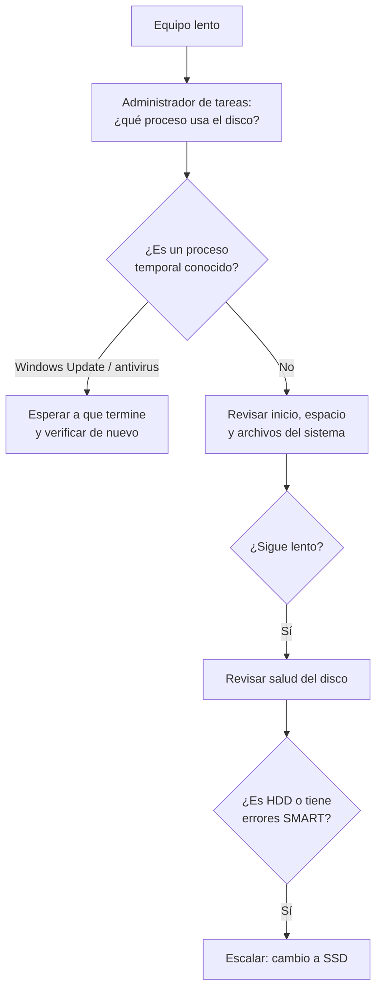

# Equipo lento al iniciar y disco al 100 %

| | |
| --- | --- |
| **Aplica a** | Windows 10 y 11 |
| **Nivel** | N1, con paso a N2 si hay falla de hardware |
| **Tiempo estimado** | 30 a 60 minutos (SFC y DISM tardan) |
| **Riesgo** | Bajo. No se borran archivos del usuario |
| **Requiere** | Permisos de administrador |

## Síntoma

El equipo tarda varios minutos en mostrar el escritorio, las aplicaciones se congelan y en el **Administrador de tareas** la columna **Disco** aparece en 100 % aunque el usuario no esté haciendo nada.

## Causas más comunes

1. Demasiados programas configurados para arrancar con Windows.
2. Poco espacio libre en la unidad C: (menos del 10 %).
3. Actualizaciones de Windows o análisis del antivirus ejecutándose en segundo plano.
4. Archivos del sistema dañados.
5. **Disco mecánico (HDD) envejecido o con sectores dañados.** Es la causa de fondo más frecuente en equipos de más de cuatro años.

## Diagnóstico



### Identificar el proceso responsable

1. `Ctrl + Shift + Esc` para abrir el **Administrador de tareas**.
2. Pestaña **Procesos**, clic en la columna **Disco** para ordenar de mayor a menor.
3. Anotar los tres procesos con más uso.


Para más detalle: pestaña **Rendimiento**, **Abrir Monitor de recursos**, pestaña **Disco**. Ahí se ve qué archivos está leyendo o escribiendo cada proceso.

| Proceso | Qué es | Acción |
| --- | --- | --- |
| `Antimalware Service Executable` | Análisis de Microsoft Defender | Esperar o programar el análisis fuera del horario laboral |
| `Windows Modules Installer Worker` / `wuauserv` | Windows Update | Dejar terminar y reiniciar |
| `SearchIndexer` | Indexación de búsqueda | Normal tras una actualización; si es constante, reconstruir el índice |
| `SysMain` | Precarga de aplicaciones | En HDD lentos puede empeorar el problema |

## Solución paso a paso

### 1. Reducir los programas de inicio

1. Administrador de tareas, pestaña **Aplicaciones de inicio** (en Windows 10: **Inicio**).
2. Revisar la columna **Impacto de inicio**.
3. **Deshabilitar** lo que no sea necesario al arrancar: actualizadores, clientes de juegos, reproductores, utilidades de impresoras.
4. No deshabilitar el antivirus, la VPN corporativa ni los controladores de audio y video.


### 2. Liberar espacio en disco

1. **Configuración > Sistema > Almacenamiento**.
2. Entrar a **Archivos temporales** y eliminar: archivos temporales, caché de Windows Update, Papelera (confirmar con el usuario).
3. Activar **Sensor de almacenamiento** para que se haga automáticamente.

Meta: dejar al menos **15 % libre** en la unidad C:.

### 3. Reparar archivos del sistema

En **Terminal** o `cmd` como administrador, en este orden:

```cmd
DISM /Online /Cleanup-Image /RestoreHealth
sfc /scannow
```

- DISM repara la imagen de Windows que usa SFC como referencia; por eso va primero.
- Cada uno puede tardar entre 10 y 30 minutos. No cerrar la ventana.
- Resultado esperado de SFC: *"Protección de recursos de Windows encontró archivos dañados y los reparó correctamente"* o *"no encontró ninguna infracción de integridad"*.

### 4. Revisar la salud del disco

En **PowerShell** como administrador:

```powershell
Get-PhysicalDisk | Select-Object FriendlyName, MediaType, HealthStatus, OperationalStatus, Size
```

- `MediaType` = **HDD** en un equipo de oficina moderno es, por sí solo, motivo suficiente para recomendar el cambio a SSD.
- `HealthStatus` distinto de **Healthy**: el disco está fallando. Respaldar los datos del usuario **antes de cualquier otra acción** y escalar.

Revisar también el **Visor de eventos** (`eventvwr.msc`) en **Registros de Windows > Sistema**, filtrando por los orígenes `disk` y `Ntfs`. Errores repetidos como *"Se detectó un bloque defectuoso"* confirman falla física.


### 5. Ajustes para equipos con HDD (mientras llega el cambio)

```powershell
# Desactiva la precarga de aplicaciones, que en discos mecánicos compite con el uso normal
Stop-Service -Name SysMain -Force
Set-Service -Name SysMain -StartupType Disabled
```

Revertir con `Set-Service -Name SysMain -StartupType Automatic` cuando el equipo tenga SSD.

## Verificación

- [ ] El escritorio aparece en menos de 2 minutos desde el encendido.
- [ ] Con el equipo en reposo, el uso de disco baja de 10 % después de 5 minutos.
- [ ] Hay al menos 15 % de espacio libre.
- [ ] SFC terminó sin errores pendientes.

## Si no se resuelve

Escalar a **soporte de hardware (N2)** con:

- Modelo del equipo y antigüedad aproximada.
- Resultado de `Get-PhysicalDisk` y errores del Visor de eventos.
- Recomendación: reemplazo de HDD por SSD y clonación del disco.

## Nota para el ticket

```text
Síntoma: inicio de ~10 min, disco al 100 % en reposo.
Diagnóstico: 14 programas en inicio, 4 GB libres de 238 GB, HDD de 5 años en buen estado SMART.
Acciones: deshabilitados 9 programas de inicio, limpieza de 31 GB, DISM + SFC sin errores, SysMain deshabilitado.
Resultado: inicio en 1 min 40 s, disco en reposo al 3 %. Se recomienda cambio a SSD.
Estado: Cerrado. Se abre solicitud de hardware.
```
