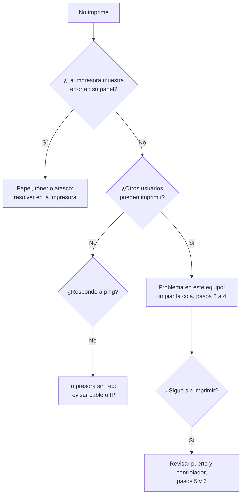

# La impresora no imprime: trabajos atascados en la cola

| | |
| --- | --- |
| **Aplica a** | Windows 10 y 11, impresoras locales (USB) y de red |
| **Nivel** | N1 |
| **Tiempo estimado** | 5 a 15 minutos |
| **Riesgo** | Bajo. Se pierden los trabajos que estaban en cola: avisar al usuario |
| **Requiere** | Permisos de administrador para los pasos 3 y 4 |

## Síntoma

El usuario envía un documento a imprimir y no sale. En la cola de impresión el trabajo aparece como **"Error"**, **"Imprimiendo"** sin avanzar o **"Eliminando"** sin desaparecer. Los documentos nuevos se quedan detrás del primero.

## Causas más comunes

1. Un trabajo dañado bloquea la cola y el servicio **Cola de impresión** (`Spooler`) no puede liberarlo.
2. La impresora está desconectada, sin papel, sin tóner o con un atasco físico.
3. La impresora de red cambió de dirección IP y el puerto configurado en Windows ya no apunta a ella.
4. El controlador está dañado o no corresponde al modelo.

## Diagnóstico



Antes de tocar el equipo:

- Mirar el panel de la impresora: papel, tóner, puertas abiertas, mensajes de atasco.
- Preguntar si otros usuarios pueden imprimir en la misma impresora. Si **nadie** puede, el problema está en la impresora o en el servidor de impresión, no en este equipo.
- Para impresoras de red, probar conectividad con su IP (está en la etiqueta o en el menú de red de la impresora):

```cmd
ping 192.168.1.50
```

## Solución paso a paso

### 1. Cancelar desde la interfaz

**Configuración > Bluetooth y dispositivos > Impresoras y escáneres**, elegir la impresora, **Abrir cola de impresión**, menú **Impresora > Cancelar todos los documentos**.

Si los trabajos desaparecen, probar imprimir de nuevo. Si se quedan en "Eliminando", seguir con el paso 2.


### 2. Detener el servicio de cola de impresión

En `cmd` como administrador:

```cmd
net stop spooler
```

Resultado esperado: *"El servicio de Cola de impresión se detuvo correctamente"*.

### 3. Borrar los trabajos pendientes

```cmd
del /Q /F %systemroot%\System32\spool\PRINTERS\*.*
```

Esa carpeta solo contiene los archivos temporales de los trabajos en cola; no se borran controladores ni configuraciones.

### 4. Iniciar de nuevo el servicio

```cmd
net start spooler
```


Abrir la cola: debe estar vacía. Imprimir una **página de prueba** (Propiedades de la impresora, **Imprimir página de prueba**).

> Los pasos 2 a 4 están automatizados en [`scripts/limpiar-cola-impresion.ps1`](scripts/limpiar-cola-impresion.ps1).

### 5. Verificar el puerto (impresoras de red)

1. **Propiedades de la impresora**, pestaña **Puertos**.
2. Comprobar que el puerto marcado tenga la **IP actual** de la impresora.
3. Si la IP cambió: **Agregar puerto > Standard TCP/IP Port**, escribir la nueva IP y seleccionarlo.

Recomendar a redes reservar una IP fija para la impresora en el DHCP para que no vuelva a pasar.

### 6. Reinstalar el controlador

1. Quitar la impresora desde **Impresoras y escáneres**.
2. Ejecutar `printui /s /t2` como administrador, pestaña **Controladores**, eliminar el controlador del modelo.
3. Descargar el controlador desde la página del fabricante y agregar la impresora de nuevo.

## Verificación

- [ ] La cola de impresión está vacía.
- [ ] La página de prueba sale completa.
- [ ] El usuario imprime el documento original desde su aplicación.

## Si no se resuelve

Escalar a **N2 / servidor de impresión** con:

- Nombre y modelo de la impresora, IP y si es compartida desde un servidor.
- Resultado del `ping` y estado del servicio (`sc query spooler`).
- Mensaje exacto del error en la cola o en el Visor de eventos (**Aplicaciones y servicios > Microsoft > Windows > PrintService**).

## Prevención

- Reservar IP fija para cada impresora de red.
- Instalar impresoras desde un servidor de impresión con controladores homologados.
- Evitar enviar archivos PDF muy pesados o escaneados a resolución máxima a impresoras con poca memoria.

## Nota para el ticket

```text
Síntoma: trabajos en cola con estado "Error", la impresora del 2.° piso no imprime desde este equipo.
Diagnóstico: otros usuarios imprimen bien; ping a la impresora correcto; trabajo dañado bloqueando la cola.
Acciones: net stop spooler, borrado de C:\Windows\System32\spool\PRINTERS, net start spooler.
Resultado: página de prueba correcta, usuario imprime su documento.
Estado: Cerrado.
```
