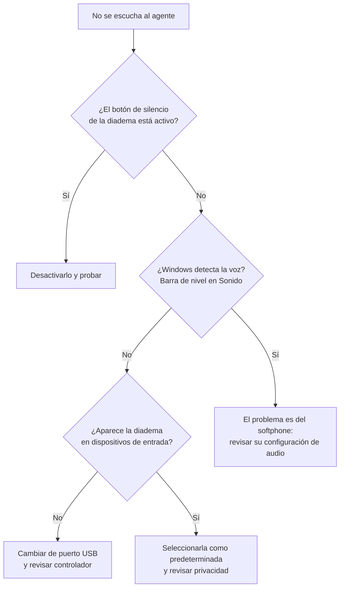

# Diadema sin micrófono o sin audio en el softphone

| | |
| --- | --- |
| **Aplica a** | Windows 10 y 11, diademas USB o de conector 3,5 mm, softphones y Teams / Zoom |
| **Nivel** | N1 |
| **Tiempo estimado** | 5 a 15 minutos |
| **Riesgo** | Bajo |
| **Contexto** | Incidencia muy frecuente en centros de contacto: un agente sin micrófono deja de atender llamadas, así que se trata como prioridad alta |

## Síntoma

El agente escucha al cliente pero **el cliente no lo escucha** (o al revés). La diadema funciona en otro equipo o en el celular. A veces el problema empezó después de desconectar y conectar la diadema o de una actualización de Windows.

## Causas más comunes

1. Windows tiene seleccionado **otro dispositivo** como entrada o salida predeterminada (el micrófono de la cámara web, los parlantes del monitor).
2. El softphone tiene configurado su propio dispositivo, distinto al de Windows.
3. La **privacidad del micrófono** está bloqueando el acceso a las aplicaciones de escritorio.
4. El micrófono está silenciado desde el botón físico de la diadema o desde el control de volumen.
5. Puerto USB defectuoso o diadema dañada.

## Diagnóstico



## Solución paso a paso

### 1. Revisar lo físico

- Botón de silencio en el cable o en el auricular (suele tener una luz roja cuando está activo).
- Brazo del micrófono bajado cerca de la boca: algunos modelos se silencian al subirlo.
- Para diademas de 3,5 mm: confirmar que el conector del micrófono (rosado) esté en la entrada de micrófono y no en la de audífonos.
- Probar otro puerto USB, preferiblemente uno directo del equipo y no de un hub o del monitor.

### 2. Elegir la diadema como dispositivo predeterminado

1. `Win + R`, escribir `mmsys.cpl` y Enter.
2. Pestaña **Grabación**: hablar en la diadema y verificar que **la barra verde se mueva** junto a ella.
3. Clic derecho sobre la diadema, **Establecer como dispositivo predeterminado** y también **Establecer como dispositivo de comunicación predeterminado**.
4. Repetir en la pestaña **Reproducción**.


En **Propiedades** del micrófono, pestaña **Niveles**, confirmar que el volumen no esté en 0 ni silenciado.

### 3. Revisar la privacidad del micrófono

**Configuración > Privacidad y seguridad > Micrófono**:

- **Acceso al micrófono**: activado.
- **Permitir que las aplicaciones accedan al micrófono**: activado.
- **Permitir que las aplicaciones de escritorio accedan al micrófono**: activado. Este último es el que afecta a la mayoría de softphones, que no son aplicaciones de la Tienda.


### 4. Configurar el audio dentro del softphone

Cada softphone (y Teams, Zoom, Webex) puede tener su propio dispositivo elegido, ignorando el predeterminado de Windows. En la configuración de audio de la aplicación:

- **Micrófono / Entrada**: la diadema por su nombre, no "Predeterminado" si hay varias opciones.
- **Altavoz / Salida**: la diadema.
- Usar la **llamada de prueba** o el medidor de nivel de la aplicación si lo tiene.

Cerrar y volver a abrir el softphone después de cambiar dispositivos: varios solo leen la lista al iniciar.

### 5. Desactivar mejoras de audio y modo exclusivo

Si se escucha entrecortado o con eco:

1. `mmsys.cpl`, **Grabación**, **Propiedades** de la diadema.
2. Pestaña **Avanzado**: desmarcar **Permitir que las aplicaciones tomen control exclusivo de este dispositivo**.
3. Pestaña **Mejoras** (si existe): desactivar todas.

### 6. Reinstalar el controlador

1. **Administrador de dispositivos > Entradas y salidas de audio**.
2. Clic derecho sobre la diadema, **Desinstalar el dispositivo**.
3. Desconectar la diadema, reiniciar, volver a conectarla.

## Verificación

- [ ] La barra de nivel se mueve al hablar en la pestaña Grabación.
- [ ] Llamada de prueba del softphone: el agente se escucha con claridad.
- [ ] El agente hace o recibe una llamada real y el cliente lo escucha.

## Si no se resuelve

- Probar la diadema en otro equipo y otra diadema en este equipo. Así se sabe si falla la diadema o el puesto.
- Si falla la diadema: **cambio de periférico** según el procedimiento de inventario.
- Si falla el puesto: escalar a **N2** con el modelo de la diadema, la versión del softphone y los pasos realizados.

## Nota para el ticket

```text
Síntoma: clientes no escuchan al agente en el softphone. La diadema funciona en el celular.
Diagnóstico: Windows tenía como entrada predeterminada el micrófono de la cámara web; el softphone usaba "Predeterminado".
Acciones: diadema establecida como dispositivo predeterminado y de comunicación; seleccionada explícitamente en el softphone.
Resultado: llamada de prueba correcta, agente vuelve a disponible.
Estado: Cerrado. Tiempo fuera de línea del agente: 12 min.
```
